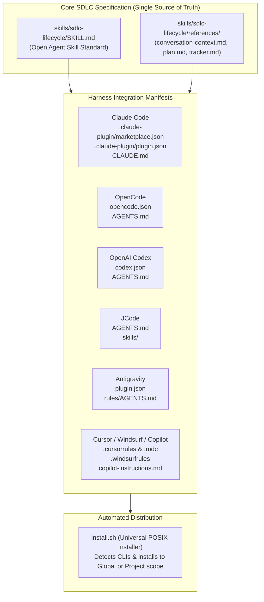

# Multi-Harness Agent Compatibility & Installation Specification

> **Scope**: Make `sdlc-lifecycle-plugin` installable across Claude Code, OpenAI Codex, OpenCode, JCode, Antigravity, Cursor, and other agent harnesses.  
> **Architecture**: Unified Agent Skill Standard with Native Manifests & Zero-Dependency POSIX Installer  
> **Status**: In Progress  
> **Last Updated**: 2026-11-07  

---

## 1. Executive Summary & Goals
The **SDLC Lifecycle Plugin** provides a rigorous 3-document anchoring system (`conversation-context.md`, `PLAN.md`, `TRACKER.md`) and a 7-stage software development lifecycle pipeline. Originally packaged exclusively for Antigravity, developers need to leverage these engineering guarantees across diverse AI coding agent harnesses in terminal, desktop, and IDE environments.

### Primary Goals:
1. **First-Class Multi-Harness Packaging**: Provide native manifests, registry configurations, and rule files for:
   - **Claude / Claude Code**: `.claude-plugin/marketplace.json`, `.claude-plugin/plugin.json`, `CLAUDE.md`.
   - **OpenAI Codex**: `codex.json`, `skills/` indexing, `AGENTS.md` instructions.
   - **OpenCode**: `opencode.json`, `.opencode/skills/` compatibility, `AGENTS.md`.
   - **JCode**: Root `AGENTS.md`, modular `skills/sdlc-lifecycle/SKILL.md`, `jcode` CLI workflow.
   - **Cursor, Windsurf, GitHub Copilot**: `.cursorrules`, `.cursor/rules/sdlc-lifecycle.mdc`, `.windsurfrules`, `.github/copilot-instructions.md`.
   - **Antigravity**: Maintain backward-compatible `plugin.json` and `rules/AGENTS.md`.
2. **Single Source of Truth**: Keep the core skill logic (`skills/sdlc-lifecycle/SKILL.md` and reference templates) strictly centralized without code duplication across formats.
3. **Automated Universal Installer (`install.sh`)**: Provide an idempotent POSIX installation script capable of detecting installed agent CLIs and configuring either global user scope or local project workspaces.
4. **Comprehensive Documentation**: Provide crystal-clear, copy-pasteable installation guides for every supported agent harness in `README.md`.

---

## 2. Scope & Boundaries

### In Scope
- Authoring Claude marketplace catalog (`.claude-plugin/marketplace.json`) and plugin manifest (`.claude-plugin/plugin.json`).
- Authoring OpenCode configuration (`opencode.json`).
- Authoring Codex configuration (`codex.json`).
- Authoring universal agent rule files:
  - Root `AGENTS.md` (read by JCode, Codex, OpenCode, and general agents).
  - Root `CLAUDE.md` (read by Claude Code and compatible tools).
  - `.cursorrules` and `.cursor/rules/sdlc-lifecycle.mdc` (read by Cursor).
  - `.windsurfrules` (read by Windsurf).
  - `.github/copilot-instructions.md` (read by GitHub Copilot).
- Authoring `install.sh` (POSIX shell script for automated cross-harness installation).
- Updating `README.md` with multi-harness badges, architecture diagram, and harness-specific installation instructions.
- Updating `.gitignore` for temporary installer outputs and artifacts.

### Out of Scope (Untouched Components)
- Modifying the core 7-stage SDLC process logic or reference templates (`skills/sdlc-lifecycle/references/*`), which already represent the golden standard.
- External cloud packaging or proprietary closed binaries.

---

## 3. Architecture & Cross-Harness Mapping

### Harness Compatibility Matrix

| Agent Harness | Discovery Protocol | Manifest / Config | Rule File | Supported Scope |
|:---|:---|:---|:---|:---:|
| **Antigravity** | `~/.gemini/config/plugins/` or `.agents/plugins/` | `plugin.json` | `rules/AGENTS.md` | Global & Project |
| **Claude Code** | `/plugin marketplace add` or `~/.claude/plugins/` | `.claude-plugin/plugin.json`, `marketplace.json` | `CLAUDE.md` | Global & Project |
| **OpenAI Codex** | `codex plugin add` or `~/.codex/skills/` | `codex.json`, `~/.codex/config.toml` | `AGENTS.md` | Global & Project |
| **OpenCode** | `.opencode/skills/` or `opencode plugin add` | `opencode.json` | `AGENTS.md` | Global & Project |
| **JCode** | `~/.jcode/skills/` or project root | `~/.jcode/config.toml` | `AGENTS.md` | Global & Project |
| **Cursor** | `.cursor/rules/*.mdc` or `.cursorrules` | N/A | `.cursorrules`, `sdlc-lifecycle.mdc` | Global & Project |
| **Windsurf** | `.windsurfrules` | N/A | `.windsurfrules` | Project |
| **Copilot** | `.github/copilot-instructions.md` | N/A | `copilot-instructions.md` | Project |

---

## 4. Manifest & Rule File Specifications

### 4.1 Claude Code Marketplace (`.claude-plugin/marketplace.json`)
Defines the repository as an official Claude Code plugin marketplace, enabling users to install the plugin via `/plugin marketplace add <repo>` and `/plugin install sdlc-lifecycle`.

### 4.2 Claude Code Manifest (`.claude-plugin/plugin.json`)
Specifies package name, semantic version, description, author, repository link, and keyword tags for Claude Code.

### 4.3 Root `AGENTS.md` & `CLAUDE.md`
Standard markdown instructions summarizing the 3-document anchoring protocol and 7-stage SDLC pipeline with direct relative links to `skills/sdlc-lifecycle/SKILL.md`.

### 4.4 OpenCode (`opencode.json`) & Codex (`codex.json`)
Declares skill entry points, schema versions, and tool requirements for OpenCode and OpenAI Codex.

### 4.5 IDE Rules (`.cursor/rules/sdlc-lifecycle.mdc`, `.windsurfrules`, `.github/copilot-instructions.md`)
Embeds always-on SDLC rules for editor-centric agents.

---

## 5. Universal Installer Specification (`install.sh`)

The script must:
1. Be written in strict POSIX-compliant shell (`/bin/sh`).
2. Provide a help menu (`--help`).
3. Support target filtering (`--target all|claude|codex|opencode|jcode|antigravity|cursor|copilot|windsurf`).
4. Support installation scope:
   - `--global` (default): installs to user configuration directories (`~/.claude/`, `~/.codex/`, `~/.config/opencode/`, `~/.jcode/`, `~/.gemini/config/plugins/`).
   - `--project <dir>`: installs directly into a target repository workspace.
5. Provide automatic CLI detection (`command -v claude`, `command -v codex`, `command -v opencode`, `command -v jcode`, `command -v agy`).
6. Support verification mode (`--verify`) to ensure installed files and symlinks are intact.
7. Support clean uninstallation (`--uninstall`).

---

## 6. Verification & Quality Gates
1. **Static Analysis**: Validate JSON schemas (`python3 -m json.tool` on all manifests) and lint shell scripts (`sh -n install.sh`).
2. **Automated Verification**: Test `install.sh` in dry-run/local mode on temporary directories simulating global and project workspaces.
3. **Cross-Harness Validation**: Verify file paths, symlinks, and directory structures across all target environments.
