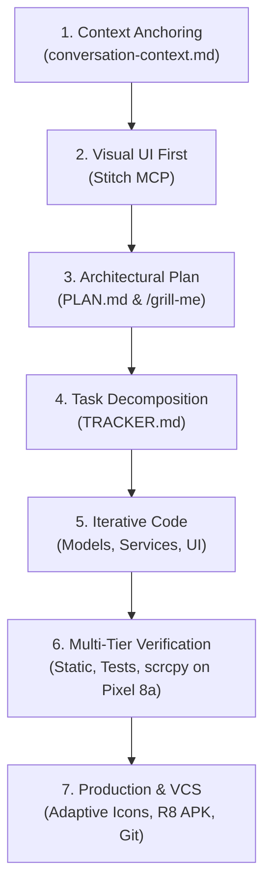

# SDLC Lifecycle Plugin for Antigravity

[](https://opensource.org/licenses/MIT)
[](#)

A production-grade **Antigravity plugin** that codifies spec-driven autonomous feature engineering. It equips your AI pair programming agent with a **3-Document Anchoring System** and an end-to-end **7-Stage Software Development Lifecycle (SDLC)** pipeline to eliminate context drift, prevent architectural regressions, and ship verified software to production.

---

## Architecture: The 3-Document Anchoring System

Complex features fail when AI models suffer from memory drift across multi-turn sessions, context compactions, and multi-day restarts. The **SDLC Lifecycle Plugin** enforces three synchronized markdown artifacts that anchor the entire development process:

```
┌────────────────────────────────────────────────────────────────────────┐
│                   THE 3-DOCUMENT ANCHORING SYSTEM                      │
├─────────────────────────┬──────────────────────┬───────────────────────┤
│ conversation-context.md │       PLAN.md        │      TRACKER.md       │
├─────────────────────────┼──────────────────────┼───────────────────────┤
│ Session Working Memory  │ Architectural Spec   │ Operational Dashboard │
│ • Human-in-the-loop sync│ • Problem statement  │ • Milestones (M1-M8)  │
│ • Decisions & trade-offs│ • Scope boundaries   │ • Granular checkboxes │
│ • Append-only history   │ • Architecture flow  │ • Live completion %   │
│ • Key toolchain facts   │ • Quality gate specs │ • Artifact links      │
└─────────────────────────┴──────────────────────┴───────────────────────┘
```

1. **`conversation-context.md`** ([Template](./skills/sdlc-lifecycle/references/conversation-context.md)): Dynamic working memory. Updated synchronously at the conclusion of each turn with an append-only audit trail.
2. **`PLAN.md`** ([Template](./skills/sdlc-lifecycle/references/plan.md)): Authoritative technical specification authored before writing code. Explicitly defines scope boundaries (protecting legacy files from accidental modification).
3. **`TRACKER.md`** ([Template](./skills/sdlc-lifecycle/references/tracker.md)): Operational milestone breakdown (`M1.1`, `M1.2`, etc.) with real-time percentage completion and direct artifact links.

---

## The 7-Stage SDLC Pipeline



1. **Stage 1: Context Anchoring & Session Setup**: Prompts the user to save session memory, records toolchain constraints, and establishes project facts.
2. **Stage 2: Visual UI Prototyping First**: Generates high-fidelity mockups with Stitch MCP before touching code to derive color tokens, typography, and responsive layout states.
3. **Stage 3: Deep Architectural Alignment**: Conducts structured alignment interviews (`/grill-me` or guided Q&A) to resolve edge cases, data models, and scope boundaries in `PLAN.md`.
4. **Stage 4: Milestone Task Decomposition**: Converts `PLAN.md` into granular numbered tasks and tracking tables in `TRACKER.md`.
5. **Stage 5: Test-Driven Iterative Implementation**: Scaffolds components, implements domain logic, and writes automated parity tests early.
6. **Stage 6: Multi-Tier Quality Gates & Live Hardware Verification**:
   - **Static Analysis**: Zero errors or warnings on linters (`flutter analyze`, `eslint`, `ruff`).
   - **Automated Tests**: 100% test pass rate.
   - **Physical Device Validation**: Deployment via ADB and display mirroring via hardware-accelerated `scrcpy`.
   - **Dynamic Debugging**: Testing real-world payloads, User-Agents, and hardware-accelerated ML inference (e.g., Google ML Kit).
7. **Stage 7: Production Optimization, Asset Branding & Git Hygiene**:
   - Generates official adaptive app icons with safe-zone keylines across all density mipmaps.
   - Configures compiler optimizations and ProGuard/R8 keep rules for minified release builds.
   - Cleanses `.gitignore` to prevent secret and cache leaks, followed by conventional git commits.

---

## Plugin Bundle Structure

```text
sdlc-lifecycle-plugin/
├── plugin.json                              # Plugin manifest metadata & prompts
├── README.md                                # User & developer documentation
├── LICENSE                                  # MIT License
├── .gitignore                               # VCS ignore rules
├── assets/
│   └── logo.svg                             # 256x256 high-contrast vector logo
├── rules/
│   └── AGENTS.md                            # Always-on SDLC rules for Antigravity
└── skills/
    └── sdlc-lifecycle/
        ├── SKILL.md                         # Detailed lifecycle runbook & checklist
        └── references/
            ├── conversation-context.md      # Template & protocol for session memory
            ├── plan.md                      # Template & protocol for PLAN.md
            └── tracker.md                   # Template & protocol for TRACKER.md
```

---

## Installation & Setup

### Option 1: Automatic Antigravity Plugin Installation

Clone directly into your global Antigravity plugins directory:

```bash
git clone https://github.com/sivanesan1098/sdlc-lifecycle-plugin.git ~/.gemini/config/plugins/sdlc-lifecycle-plugin
```

Antigravity will automatically detect the plugin on startup or turn refresh.

### Option 2: Project-Level Customization

To enforce this SDLC workflow on a specific repository:

```bash
mkdir -p .agents/plugins
git submodule add https://github.com/sivanesan1098/sdlc-lifecycle-plugin.git .agents/plugins/sdlc-lifecycle-plugin
```

---

## Suggested Starter Prompts

- *"Plan and execute a new feature using the SDLC lifecycle 3-document anchoring system"*
- *"Audit this project's feature progress and update PLAN.md and TRACKER.md"*
- *"Run the SDLC multi-tier quality gates: static analysis, unit tests, and device verification"*

---

## License

This project is licensed under the MIT License - see the [LICENSE](./LICENSE) file for details.

Authored by **Sivanesan Dharumadurai** ([@sivanesan1098](https://github.com/sivanesan1098)).
