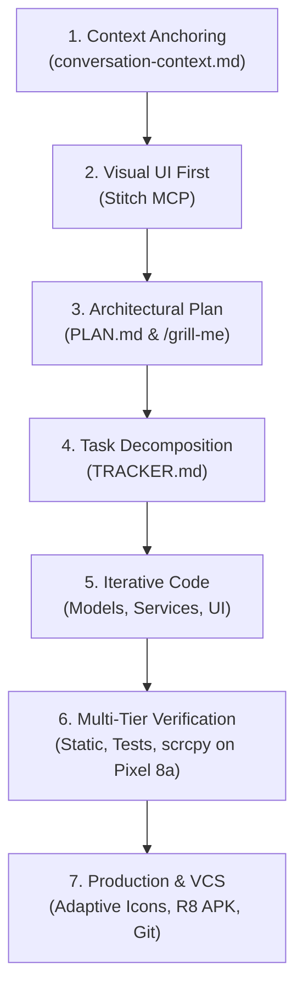

# SDLC Lifecycle Plugin for AI Coding Agents

[](https://opensource.org/licenses/MIT)
[](#supported-agent-harnesses)
[](https://github.com/sivanesan1098/sdlc-lifecycle-plugin)

A production-grade, multi-harness plugin and skill pack that codifies spec-driven autonomous feature engineering. It equips your AI pair programming agent with a **3-Document Anchoring System** and an end-to-end **7-Stage Software Development Lifecycle (SDLC)** pipeline to eliminate context drift, prevent architectural regressions, and ship verified software to production.

---

## Supported Agent Harnesses

The plugin adheres to the open **Agent Skills Standard** and includes native manifests, rules, and discovery files for all major harnesses:

| Agent Harness | Discovery Protocol | Manifest / Config | Rule File | Scope |
|:---|:---|:---|:---|:---:|
| **Claude Code** | Marketplace (`/plugin marketplace add`) or `~/.claude/` | `.claude-plugin/plugin.json`, `marketplace.json` | `CLAUDE.md` | Global & Project |
| **OpenAI Codex** | CLI (`codex plugin add`) or `~/.codex/` | `codex.json`, `~/.codex/config.toml` | `AGENTS.md` | Global & Project |
| **OpenCode** | CLI (`opencode plugin add`) or `.opencode/` | `opencode.json` | `AGENTS.md` | Global & Project |
| **JCode** | Swarm CLI or `~/.jcode/` | `~/.jcode/config.toml` | `AGENTS.md` | Global & Project |
| **Antigravity** | Plugin Manager or `~/.gemini/config/plugins/` | `plugin.json` | `rules/AGENTS.md` | Global & Project |
| **Cursor** | `.cursorrules` / `.cursor/rules/` | N/A | `sdlc-lifecycle.mdc` | Global & Project |
| **Windsurf & Copilot**| `.windsurfrules` / `.github/` | N/A | `copilot-instructions.md`| Project |

---

## Quickstart: Universal One-Line Installer

You can install the SDLC Lifecycle Plugin to all detected harnesses on your system with a single command:

```bash
curl -fsSL https://raw.githubusercontent.com/sivanesan1098/sdlc-lifecycle-plugin/main/install.sh | bash
```

Or from a local clone:

```bash
git clone https://github.com/sivanesan1098/sdlc-lifecycle-plugin.git
cd sdlc-lifecycle-plugin
./install.sh
```

---

## Architecture: The 3-Document Anchoring System

Complex features fail when AI models suffer from memory drift across multi-turn sessions, context compactions, and multi-day restarts. The **SDLC Lifecycle Plugin** enforces three synchronized markdown artifacts that anchor the entire development process:

```
┌────────────────────────────────────────────────────────────────────────┐
│                   THE 3-DOCUMENT ANCHORING SYSTEM                      │
├─────────────────────────┬──────────────────────┬───────────────────────┤
│ conversation-context.md │       PLAN.md        │      TRACKER.md       │
├─────────────────────────┼──────────────────────┼───────────────────────┤
│ Session Working Memory  │ Architectural Spec   │ Operational Dashboard │
│ • Human-in-the-loop sync│ • Problem statement  │ • Milestones (M1-M8)  │
│ • Decisions & trade-offs│ • Scope boundaries   │ • Granular checkboxes │
│ • Append-only history   │ • Architecture flow  │ • Live completion %   │
│ • Key toolchain facts   │ • Quality gate specs │ • Artifact links      │
└─────────────────────────┴──────────────────────┴───────────────────────┘
```

1. **`conversation-context.md`** ([Template](./skills/sdlc-lifecycle/references/conversation-context.md)): Dynamic working memory. Updated synchronously at the conclusion of each turn with an append-only audit trail.
2. **`PLAN.md`** ([Template](./skills/sdlc-lifecycle/references/plan.md)): Authoritative technical specification authored before writing code. Explicitly defines scope boundaries (protecting legacy files from accidental modification).
3. **`TRACKER.md`** ([Template](./skills/sdlc-lifecycle/references/tracker.md)): Operational milestone breakdown (`M1.1`, `M1.2`, etc.) with real-time percentage completion and direct artifact links.

---

## The 7-Stage SDLC Pipeline



1. **Stage 1: Context Anchoring & Session Setup**: Prompts the user to save session memory, records toolchain constraints, and establishes project facts.
2. **Stage 2: Visual UI Prototyping First**: Generates high-fidelity mockups with Stitch MCP before touching code to derive color tokens, typography, and responsive layout states.
3. **Stage 3: Deep Architectural Alignment**: Conducts structured alignment interviews (`/grill-me` or guided Q&A) to resolve edge cases, data models, and scope boundaries in `PLAN.md`.
4. **Stage 4: Milestone Task Decomposition**: Converts `PLAN.md` into granular numbered tasks and tracking tables in `TRACKER.md`.
5. **Stage 5: Test-Driven Iterative Implementation**: Scaffolds components, implements domain logic, and writes automated parity tests early.
6. **Stage 6: Multi-Tier Quality Gates & Live Hardware Verification**:
   - **Static Analysis**: Zero errors or warnings on linters (`flutter analyze`, `eslint`, `ruff`, `cargo check`).
   - **Automated Tests**: 100% test pass rate.
   - **Physical Device Validation**: Deployment via ADB and display mirroring via hardware-accelerated `scrcpy`.
   - **Dynamic Debugging**: Testing real-world payloads, User-Agents, and hardware-accelerated ML inference (e.g., Google ML Kit).
7. **Stage 7: Production Optimization, Asset Branding & Git Hygiene**:
   - Generates official adaptive app icons with safe-zone keylines across all density mipmaps.
   - Configures compiler optimizations and ProGuard/R8 keep rules for minified release builds.
   - Cleanses `.gitignore` to prevent secret and cache leaks, followed by conventional git commits.

---

## Installation by Harness

### 1. Claude Code

#### Option A: Claude Code Plugin Marketplace (Recommended)
Add the marketplace catalog and install in one step:

```bash
/plugin marketplace add sivanesan1098/sdlc-lifecycle-plugin
/plugin install sdlc-lifecycle@sdlc-lifecycle
```

Or from your shell:

```bash
claude plugin marketplace add sivanesan1098/sdlc-lifecycle-plugin
claude plugin install sdlc-lifecycle@sdlc-lifecycle
```

#### Option B: Automated Script
```bash
./install.sh --target claude
```

---

### 2. OpenAI Codex

#### Option A: Codex Plugin Marketplace
```bash
codex plugin marketplace add sivanesan1098/sdlc-lifecycle-plugin
codex plugin add sdlc-lifecycle
```

#### Option B: Manual Configuration (`~/.codex/config.toml`)
Register the skill directly in your Codex configuration:

```toml
[[skills.config]]
path = "/path/to/sdlc-lifecycle-plugin/skills/sdlc-lifecycle/SKILL.md"
enabled = true
```

#### Option C: Automated Script
```bash
./install.sh --target codex
```

---

### 3. OpenCode

#### Option A: OpenCode CLI
```bash
opencode plugin add https://github.com/sivanesan1098/sdlc-lifecycle-plugin
```

#### Option B: Automated Script
```bash
./install.sh --target opencode
```

This places the skill in `~/.config/opencode/skills/sdlc-lifecycle` and links `AGENTS.md`.

---

### 4. JCode

`jcode` is a high-performance terminal agent harness written in Rust. It natively reads project `AGENTS.md` and modular skills:

#### Option A: Automated Script
```bash
./install.sh --target jcode
```

#### Option B: Workspace Setup
Simply copy or link `AGENTS.md` and `skills/` to your project root. `jcode` will automatically discover the SDLC skill and evaluate conversation turns against `SKILL.md`.

---

### 5. Google Antigravity

#### Option A: Global Plugin Directory
Clone directly into your global Antigravity plugins directory:

```bash
git clone https://github.com/sivanesan1098/sdlc-lifecycle-plugin.git ~/.gemini/config/plugins/sdlc-lifecycle-plugin
```

#### Option B: Project-Level Submodule
```bash
mkdir -p .agents/plugins
git submodule add https://github.com/sivanesan1098/sdlc-lifecycle-plugin.git .agents/plugins/sdlc-lifecycle-plugin
```

---

### 6. Cursor, Windsurf & GitHub Copilot

Install rules into any project workspace:

```bash
./install.sh --project /path/to/my-repo
```

This automatically generates:
- `.cursorrules` and `.cursor/rules/sdlc-lifecycle.mdc`
- `.windsurfrules`
- `.github/copilot-instructions.md`
- Root `AGENTS.md` & `CLAUDE.md`

---

## Windows Installation (PowerShell)

For Windows developers running PowerShell:

```powershell
# Install to all detected harnesses
.\install.ps1 -All

# Or install to specific harnesses
.\install.ps1 -Claude -OpenCode -Jcode

# Install into a local repository workspace
.\install.ps1 -Project "C:\path\to\my-repo"

# Inspect installation status across harnesses
.\install.ps1 -Status

# Uninstall from all harnesses
.\install.ps1 -Uninstall -All
```

---

## Universal Project Installation (Any Repository)

To equip **any** existing git repository with full SDLC lifecycle enforcement across all agents:

```bash
./install.sh --project .
```

---

## Verification & Health Check

Verify your installation status across all harnesses anytime:

```bash
./install.sh --verify
```

Or run the automated test suite:

```bash
./test/test_installer.sh
```

Example output:
```text
Verifying SDLC Lifecycle installation status...

  ✓ Antigravity Global        found: ~/.gemini/config/plugins/sdlc-lifecycle-plugin/plugin.json
  ✓ Claude Code Global        found: ~/.claude/skills/sdlc-lifecycle/SKILL.md
  ✓ Claude Code Command       found: ~/.claude/commands/sdlc.md
  ✓ Claude Code Plugin        found: ~/.claude/plugins/sdlc-lifecycle/.claude-plugin/plugin.json
  ✓ OpenAI Codex Global       found: ~/.codex/skills/sdlc-lifecycle/SKILL.md
  ✓ OpenCode Global           found: ~/.config/opencode/skills/sdlc-lifecycle/SKILL.md
  ✓ JCode Global              found: ~/.jcode/skills/sdlc-lifecycle/SKILL.md
  ✓ Cursor Global Rules       found: ~/.cursor/rules/sdlc-lifecycle.mdc
```

---

## Repository Structure

```text
sdlc-lifecycle-plugin/
├── install.sh                               # Universal multi-harness installer (POSIX bash/sh)
├── install.ps1                              # Universal Windows PowerShell installer
├── plugin.json                              # Antigravity plugin manifest
├── codex.json                               # OpenAI Codex skill manifest
├── opencode.json                            # OpenCode plugin manifest
├── AGENTS.md                                # Universal agent rules (Codex, JCode, OpenCode)
├── CLAUDE.md                                # Claude Code instruction rules
├── .cursorrules                             # Cursor agent rules
├── .windsurfrules                           # Windsurf Cascade rules
├── README.md                                # User & developer documentation
├── LICENSE                                  # MIT License
├── .gitignore                               # VCS ignore rules
├── .claude-plugin/
│   ├── marketplace.json                     # Claude Code marketplace catalog
│   └── plugin.json                          # Claude Code plugin manifest
├── commands/
│   └── sdlc.md                              # Claude Code /sdlc slash command
├── .cursor/
│   └── rules/
│       └── sdlc-lifecycle.mdc               # Cursor IDE structured rule
├── .github/
│   └── copilot-instructions.md              # GitHub Copilot rules
├── assets/
│   └── logo.svg                             # 256x256 high-contrast vector logo
├── rules/
│   └── AGENTS.md                            # Antigravity plugin rules
├── test/
│   └── test_installer.sh                    # Multi-harness verification test suite
└── skills/
    └── sdlc-lifecycle/
        ├── SKILL.md                         # Detailed lifecycle runbook & checklist
        └── references/
            ├── conversation-context.md      # Template & protocol for session memory
            ├── plan.md                      # Template & protocol for PLAN.md
            └── tracker.md                   # Template & protocol for TRACKER.md
```

---

## Suggested Starter Prompts

- *"Plan and execute a new feature using the SDLC lifecycle 3-document anchoring system"*
- *"Audit this project's feature progress and update PLAN.md and TRACKER.md"*
- *"Run the SDLC multi-tier quality gates: static analysis, unit tests, and device verification"*

---

## License

This project is licensed under the MIT License - see the [LICENSE](./LICENSE) file for details.

Authored by **Sivanesan Dharumadurai** ([@sivanesan1098](https://github.com/sivanesan1098)).
