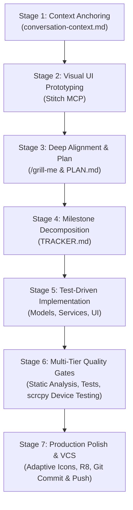

# SDLC Lifecycle: Spec-Driven Autonomous Feature Engineering

The **SDLC Lifecycle** skill codifies a rigorous, battle-tested software engineering process designed for high-velocity pair programming with AI agents. It eliminates context drift, prevents architectural regressions, and guarantees production-ready software through a **3-Document Anchoring System** and a **7-Stage Execution Pipeline**.

---

## The 3-Document Anchoring System

To maintain absolute alignment across multi-turn sessions, context compactions, and multi-agent interactions, establish three synchronized documents:

```
┌────────────────────────────────────────────────────────────────────────┐
│                   3-DOCUMENT ANCHORING SYSTEM                          │
├─────────────────────────┬──────────────────────┬───────────────────────┤
│ conversation-context.md │       PLAN.md        │      TRACKER.md       │
├─────────────────────────┼──────────────────────┼───────────────────────┤
│ Session Memory Layer    │ Architecture Spec    │ Operational Dashboard │
│ • User Preferences     │ • Problem Statement  │ • Milestones (M1-M8)  │
│ • Decisions Made        │ • Scope Boundaries   │ • Granular Tasks      │
│ • Append-Only History   │ • Data Flow & Models │ • Completion %        │
│ • Key Constraints       │ • Exit Criteria      │ • Verification Links  │
└─────────────────────────┴──────────────────────┴───────────────────────┘
```

1. **`conversation-context.md`** ([Template](./references/conversation-context.md)):
   - **Role**: Dynamic working memory and human-in-the-loop audit log.
   - **Update Frequency**: Checked at conversation start; updated synchronously whenever architectural decisions, trade-offs, or task completions occur.
   - **Rule**: Outdated entries are struck through (`~~decision~~`) rather than deleted, preserving decision lineage.

2. **`PLAN.md`** ([Template](./references/plan.md)):
   - **Role**: Comprehensive technical blueprint authored *before* any implementation begins.
   - **Key Focus**: Explicit scope boundaries (what is in scope vs. legacy files that must remain strictly untouched), data flows, dependency choices, and quality gates.

3. **`TRACKER.md`** ([Template](./references/tracker.md)):
   - **Role**: Granular, single-source-of-truth progress dashboard.
   - **Structure**: Directly decomposes `PLAN.md` into numbered Milestones (`M1.1`, `M1.2`, etc.) with checkboxes and live completion percentages.

---

## The 7-Stage SDLC Lifecycle Pipeline



---

### Stage 1: Context Anchoring & Session Setup
- **Goal**: Establish persistent memory and record user constraints before touching code.
- **Actions**:
  1. Check if `conversation-context.md` exists. If not, prompt user:
     `"Save context to conversation-context.md for future sessions? (Yes/No)"`
  2. Record core objectives, workspace roots, user preferences, and platform facts.
  3. Confirm the creation or update of the file explicitly.

---

### Stage 2: Visual & UX Specification First (Stitch MCP)
- **Goal**: Lock down UI/UX expectations and generate pixel-accurate design tokens prior to coding.
- **Actions**:
  1. Create a dedicated project in Stitch MCP (e.g. `create_project`).
  2. Generate all core application views (Home, Results, Loading Steppers, Error/Empty states) using fast generative models (`GEMINI_3_5_FLASH_LITE`).
  3. Download high-resolution screenshots to a local project directory (`stitch/screens/`).
  4. Extract the color palette, typography hierarchy, spacing system, and component states directly from the visual prototypes.

---

### Stage 3: Deep Architectural Alignment & Planning (`PLAN.md`)
- **Goal**: Exhaustively resolve design decisions, technical constraints, and scope boundaries.
- **Actions**:
  1. Run an interactive alignment interview (e.g. `/grill-me` or structured multi-turn Q&A) addressing:
     - Target platform & runtime constraints (e.g., 100% on-device vs. cloud-connected).
     - Legacy file preservation (e.g., keeping backend or web files untouched).
     - State management and concurrency architecture.
  2. Author a structured `PLAN.md` with:
     - Component breakdown (UI, State, Domain, Hardware/ML).
     - Detailed data models and API schemas.
     - Specific exit criteria for each phase.

---

### Stage 4: Granular Operational Decomposition (`TRACKER.md`)
- **Goal**: Convert the static plan into a live, actionable execution dashboard.
- **Actions**:
  1. Translate every major section of `PLAN.md` into distinct Milestones (`M1` to `M8`).
  2. Break each milestone into concrete subtasks with explicit checkboxes (`- [ ]`).
  3. Include an executive summary table tracking percentage completion.
  4. Update `conversation-context.md` with the new tracking milestones.

---

### Stage 5: Iterative Test-Driven Implementation
- **Goal**: Implement features modularly with automated regression harnesses.
- **Actions**:
  1. **Scaffold Project**: Initialize project structure (e.g. `flutter create`, `npm create`, `poetry init`) and pin dependencies.
  2. **Core Domain Services**: Implement models, network services, scrapers, and hardware/ML wrappers.
  3. **Unit Tests Early**: Write test suites verifying parity against reference implementations (e.g., URL regex parsing, canonical normalization).
  4. **State & Reactive UI**: Implement state management and compose UI widgets mirroring the Stitch prototypes.

---

### Stage 6: Multi-Tier Quality Gates & Live Hardware Verification
- **Goal**: Validate functionality across software abstractions and physical hardware.

```
┌────────────────────────────────────────────────────────────────────────┐
│                        MULTI-TIER QUALITY GATES                        │
├─────────────────┬──────────────────────────────────────────────────────┤
│ Gate 1: Static  │ 0 errors/warnings on linter (flutter analyze / ruff) │
├─────────────────┼──────────────────────────────────────────────────────┤
│ Gate 2: Tests   │ 100% unit & widget test pass rate (flutter test)    │
├─────────────────┼──────────────────────────────────────────────────────┤
│ Gate 3: Device  │ Deploy debug APK via ADB to physical device (Pixel)  │
├─────────────────┼──────────────────────────────────────────────────────┤
│ Gate 4: Mirror  │ Stream live screen via scrcpy (Metal / HW accelerated)│
├─────────────────┼──────────────────────────────────────────────────────┤
│ Gate 5: Dynamic │ Test with live clipboard data, inspect OCR & network │
└─────────────────┴──────────────────────────────────────────────────────┘
```

- **Dynamic Debugging Best Practices**:
  - If third-party APIs/web scraping fail on real devices (e.g. Instagram login walls), inspect HTTP headers and adapt User-Agents (e.g. crawler bots like `facebookexternalhit/1.1`).
  - Capture live device screenshots into `stitch/screens/` to document physical verification.

---

### Stage 7: Production Optimization, Asset Branding & Git Hygiene
- **Goal**: Ship production-grade, minified artifacts with clean source control tracking.
- **Actions**:
  1. **App Branding**:
     - Design official master icon with Stitch MCP (`deviceType: AGNOSTIC`).
     - Generate adaptive icon layers with 72% safe-zone keylines.
     - Populate complete density mipmap directories (`mdpi` through `xxxhdpi`).
  2. **Compiler Optimization & Minification**:
     - Configure ProGuard / R8 keep rules to handle unbundled native libraries (e.g. ML Kit text recognition).
     - Build release binaries (`flutter build apk --release`) and verify size reduction.
  3. **VCS Hygiene**:
     - Update `.gitignore` with categorized sections (tool caches, secret keys, design mockups, ephemeral build outputs).
     - Verify `git status --ignored` to ensure no sensitive or generated files leak into tracking.
     - Craft atomic conventional commits and push directly to feature branch.

---

## SDLC Execution Checklist

Use this checklist to ensure complete adherence during any major feature delivery:

- [ ] `conversation-context.md` established and confirmed with user.
- [ ] Stitch MCP UI screens generated and saved locally to `stitch/screens/`.
- [ ] Architectural interview completed and codified in `PLAN.md`.
- [ ] `TRACKER.md` created with granular milestones and progress table.
- [ ] Automated unit test suite implemented and passing (100% green).
- [ ] Zero linter / static analysis warnings (`flutter analyze` / `eslint`).
- [ ] Physical device deployment and dynamic debugging verified via `scrcpy`.
- [ ] Official adaptive app icon generated across all mipmap densities.
- [ ] ProGuard / R8 rules configured; minified release build compiled successfully.
- [ ] `.gitignore` refined to isolate ephemeral/secret files.
- [ ] Conventional git commit staged, committed, and pushed to remote.
- [ ] `conversation-context.md` updated with final decisions and confirmed.

